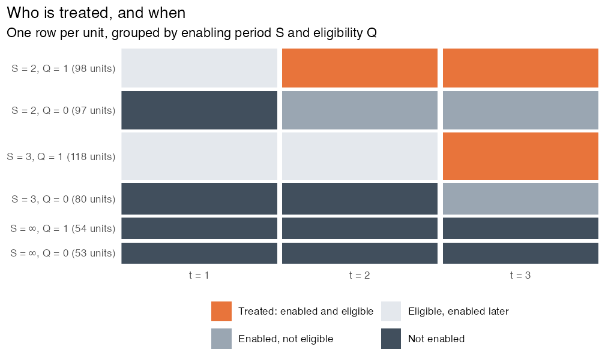
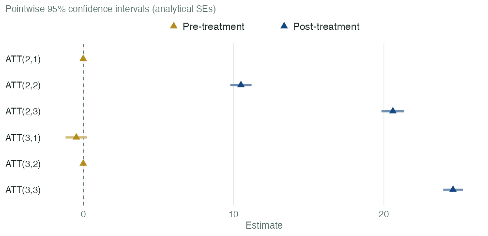
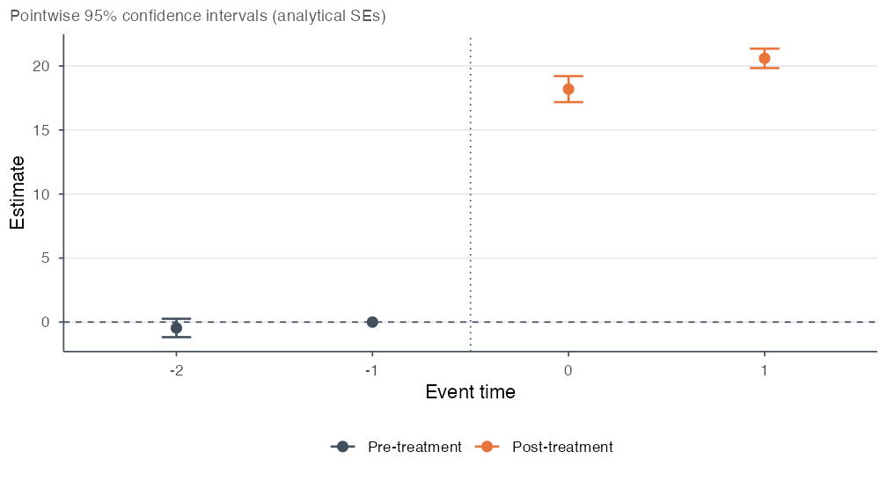
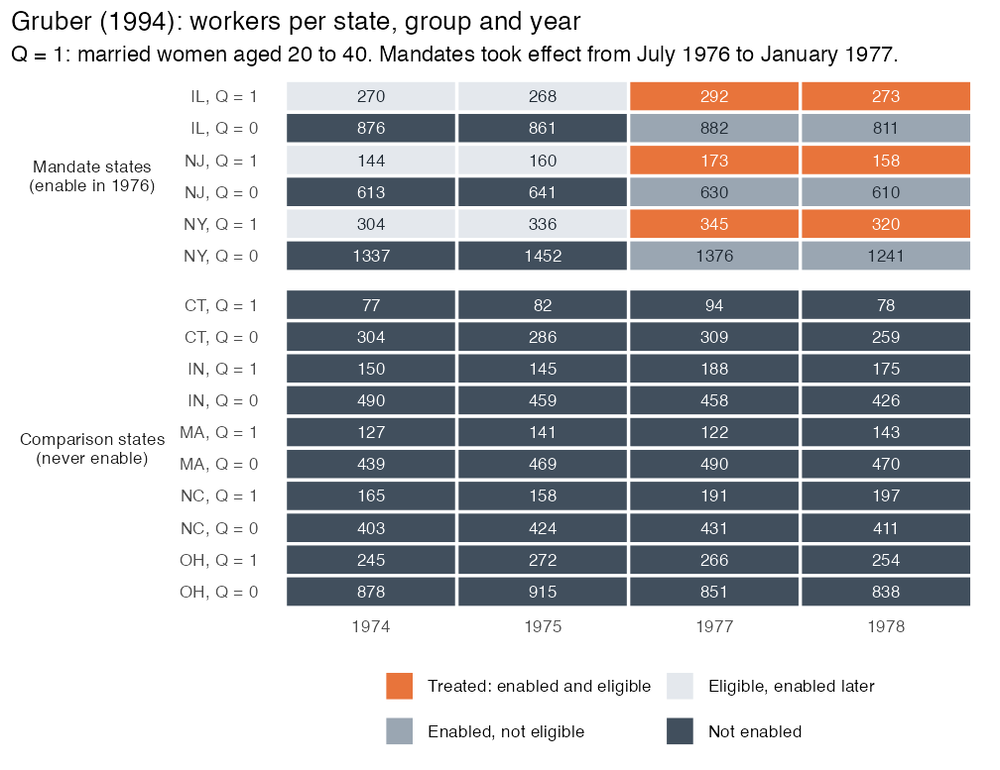
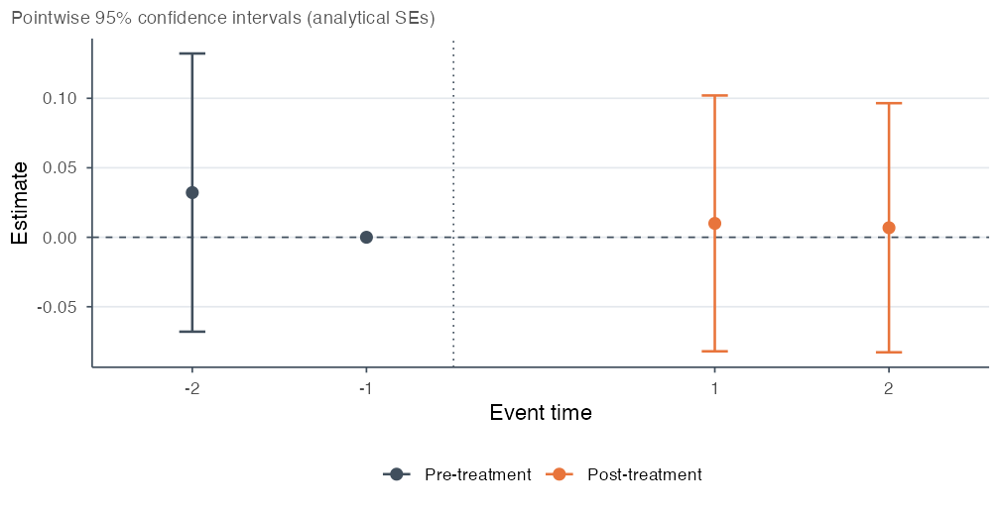

<!-- README.md is generated from README.Rmd. Please edit that file -->

<p align="center">
  
</p>
<h1 align="center">Triple-Difference Estimators</h1>
<p align="center">
  Average treatment effects and event studies for triple-difference (DDD) designs,<br/>
  with two periods or staggered adoption, and with panel or repeated cross-section data.
</p>
<p align="center">
  <a href="https://CRAN.R-project.org/package=triplediff"></a>
  <a href="https://CRAN.R-project.org/package=triplediff"></a>
  <a href="https://lifecycle.r-lib.org/articles/stages.html#experimental"></a>
  <a href="https://github.com/marcelortizv/triplediff"></a>
  <a href="https://doi.org/10.48550/arXiv.2505.09942"></a>
</p>
<p align="center">
  <a href="https://marcelortiz.com/triplediff/">Website</a> &middot;
  <a href="https://marcelortiz.com/triplediff/reference/index.html">Reference</a> &middot;
  <a href="https://marcelortiz.com/triplediff/news/index.html">Changelog</a> &middot;
  <a href="https://marcelortiz.com/assets/pdf/DDD_OVS.pdf">Paper (PDF)</a> &middot;
  <a href="https://arxiv.org/abs/2505.09942">arXiv</a> &middot;
  <a href="#citation">Cite</a> &middot;
  <a href="https://github.com/marcelortizv/triplediff/issues">Report a bug</a>
</p>
<br/>
<p align="center">
  
</p>
<p align="center"><sub>Three steps: look at the raw panel, let <code>ddd()</code> compute each ATT(g,t) as a two-period DDD, and let <code>agg_ddd()</code> average them into an event study. The animation uses the simulated panel of the <a href="#quick-start">Quick start</a> with not-yet-treated comparison groups.</sub></p>

## What triplediff does

**triplediff** is an R package for computing average treatment effects
in Triple Differences Designs (also known as
Difference-in-Differences-in-Differences or DDD). DDD designs are widely
used in empirical work to relax parallel trends assumptions in
Difference-in-Differences settings. This package provides functions to
estimate group-time average treatment effect and event-study type
estimands associated with DDD designs. The setups allowed are:

- Two-periods or Multiple Periods DDD.
- Single Treatment Date and Variation in Treatment Timing (i.e.,
  staggered adoption).
- Conditional and Unconditional DDD parallel trends assumptions.

The `triplediff` package implements the framework proposed in:

- [Ortiz-Villavicencio, Marcelo and Pedro H.C. Sant’Anna. "Better
  Understanding Triple Differences Estimators",
  2025.](https://arxiv.org/abs/2505.09942)

## Installation

Install the released version from CRAN:

``` r
install.packages("triplediff")
```

Or install the development version from GitHub:

``` r
# install.packages("devtools")
devtools::install_github("marcelortizv/triplediff")
```

This README uses version 0.3.0. The `gruber1994` data and the `plot()`
methods are new in version 0.3.0.

## Quick start

We provide a quick start example to illustrate the main features of the
package. The UX is designed to be similar to the `did` package, so users
familiar with it should feel comfortable using `triplediff`.

`ddd` is the main function for computing the DDD estimators proposed in
[Ortiz-Villavicencio and Sant’Anna
(2025)](https://arxiv.org/abs/2505.09942). At its core, `ddd` employs
regression adjustment, inverse probability weighting, and doubly robust
estimators that are valid under conditional DDD parallel trends.

To use `ddd`, the minimal data requirements include:

- `id`: Unit unique identifier (e.g., firm, individual, etc.). Its
  column name is associated with parameter `idname`.

- `period`: Time identifier (e.g., year, month, etc.). Its column name
  is associated with parameter `tname`.

- `outcome`: Outcome variable of interest. Its column name is associated
  with parameter `yname`.

- `state`: First period when treatment is enabled for a particular unit.
  It is a positive number for treated units and defines which group the
  unit belongs to. It takes value `0` or `Inf` for never-enabling units.
  Its column name is associated with parameter `gname`.

- `partition`: This is an indicator variable that is 1 for the units
  eligible for treatment and 0 otherwise. Its column name is associated
  with parameter `pname`.

Below, S is the period in which a unit’s group enables treatment (the
`gname` column), and Q is eligibility (the `pname` column). A unit is
treated in period t when t ≥ S and Q = 1. A group with S = 0 or `Inf`
never enables treatment. We write this as S = ∞.

The following are two simplified examples of how to use the `ddd`
function. The first one is a multiple-period DDD setup with staggered
treatment adoption. It goes from the raw data to an event study. The
second one is a two-period DDD setup.

### Multiple periods with staggered adoption: from the data to an event study

First, we can simulate some data with a built-in function
`gen_dgp_mult_periods` that generates a multiple-period DDD setup with
staggered treatment adoption. This function receives the number of units
and the type of DGP design to generate. The `gen_dgp_mult_periods`
function returns a data frame with the required columns for the `ddd`
function with 4 covariates.

``` r
set.seed(1234) # Set seed for reproducibility
# Simulate data for a multiple-period DDD setup with staggered treatment adoption
data <- gen_dgp_mult_periods(size = 500, dgp_type = 1)$data

head(data)
#> Key: <id>
#>       id state partition  time         y        cov1       cov2       cov3
#>    <int> <num>     <num> <int>     <num>       <num>      <num>      <num>
#> 1:     1     3         1     1 1371.1923 -0.97080934  1.3995704 1.48834130
#> 2:     1     3         1     2 1690.9157 -0.97080934  1.3995704 1.48834130
#> 3:     1     3         1     3 2034.5661 -0.97080934  1.3995704 1.48834130
#> 4:     2     2         1     1  934.0812  0.02591115 -0.9747527 0.01714001
#> 5:     2     2         1     2 1189.5495  0.02591115 -0.9747527 0.01714001
#> 6:     2     2         1     3 1444.1072  0.02591115 -0.9747527 0.01714001
#>          cov4 cluster
#>         <num>   <int>
#> 1:  0.3853346      27
#> 2:  0.3853346      27
#> 3:  0.3853346      27
#> 4: -0.7822000      45
#> 5: -0.7822000      45
#> 6: -0.7822000      45
```

**Step 1: look at the data.** Each unit belongs to one of six groups:
its enabling period S (2, 3 or ∞) and its eligibility Q (1 or 0). The
heatmap draws one row per unit and one column per period. Only the
eligible units of a group that has enabled treatment are treated.

<details><summary>Show the ggplot2 code for this figure</summary>

``` r
library(ggplot2)

# Status of each unit in each period. S is the enabling period (`state`,
# 0 = never), Q is eligibility (`partition`), t is the period (`time`).
status_of <- function(S, Q, t) {
  enabled <- S != 0 & t >= S
  ifelse(enabled & Q == 1, "Treated: enabled and eligible",
  ifelse(enabled,          "Enabled, not eligible",
  ifelse(S != 0 & Q == 1,  "Eligible, enabled later", "Not enabled")))
}
status_colors <- c("Treated: enabled and eligible" = "#E8743B",
                   "Eligible, enabled later"       = "#E4E8ED",
                   "Enabled, not eligible"         = "#9AA6B2",
                   "Not enabled"                   = "#414F5D")

units <- unique(as.data.frame(data)[, c("id", "state", "partition")])
units <- units[order(match(units$state, c(2, 3, 0)), -units$partition, units$id), ]
block <- paste(match(units$state, c(2, 3, 0)), 1 - units$partition)  # one block per (S, Q)
units$row <- seq_len(nrow(units)) + 8 * (match(block, unique(block)) - 1)  # gaps between blocks

cells <- merge(as.data.frame(data), units[, c("id", "row")], by = "id")
cells$status <- factor(status_of(cells$state, cells$partition, cells$time),
                       levels = names(status_colors))
labels <- aggregate(row ~ state + partition, data = units,
                    FUN = function(r) c(mid = mean(r), n = length(r)))
labels <- data.frame(labels[1:2], labels$row)
labels$text <- sprintf("S = %s, Q = %d (%d units)",
                       ifelse(labels$state == 0, "∞", labels$state),
                       labels$partition, labels$n)

p_heat <- ggplot(cells, aes(x = time, y = row, fill = status)) +
  geom_tile(width = 0.97, height = 1) +
  scale_fill_manual(values = status_colors, drop = FALSE, name = NULL) +
  scale_y_reverse(breaks = labels$mid, labels = labels$text, expand = c(0.01, 0)) +
  scale_x_continuous(breaks = 1:3, labels = paste("t =", 1:3), expand = c(0, 0)) +
  labs(x = NULL, y = NULL,
       title = "Who is treated, and when",
       subtitle = "One row per unit, grouped by enabling period S and eligibility Q") +
  theme_minimal(base_size = 11) +
  theme(panel.grid = element_blank(), legend.position = "bottom",
        plot.title.position = "plot") +
  guides(fill = guide_legend(nrow = 2, byrow = TRUE))
```

</details>



DDD compares the treated cells with three comparison groups. For
ATT(2,2) with `control_group = "nevertreated"`, these are the ineligible
units of the S = 2 group, and the eligible and the ineligible units of
the S = ∞ group. The comparison uses the change from t = 1 to t = 2 in
each group.

**Step 2: estimate the group-time effects.** Now we can estimate the
group-time average treatment effect on the treated using the `ddd`
function.

``` r
# Estimate the group-time average treatment effect in DDD

att_gt <- ddd(yname = "y", tname = "time", idname = "id", gname = "state", 
              pname = "partition", xformla = ~cov1 + cov2 + cov3 + cov4,
              data = data, control_group = "nevertreated", 
              base_period = "universal", est_method = "dr")

summary(att_gt)
#>  Call:
#> ddd(yname = "y", tname = "time", idname = "id", gname = "state", 
#>     pname = "partition", xformla = ~cov1 + cov2 + cov3 + cov4, 
#>     data = data, control_group = "nevertreated", base_period = "universal", 
#>     est_method = "dr")
#> =========================== DDD Summary ==============================
#>  DR-DDD estimation for the ATT(g,t): 
#> Group Time  ATT(g,t)  Std. Error [95% Pointwise  Conf. Band]  
#>   2    1       0.0000         NA           NA            NA   
#>   2    2      10.4901     0.3613       9.7819       11.1983  *
#>   2    3      20.5986     0.3868      19.8405       21.3568  *
#>   3    1      -0.4593     0.3660      -1.1767        0.2580   
#>   3    2       0.0000         NA           NA            NA   
#>   3    3      24.5983     0.3333      23.9450       25.2515  *
#> 
#>  Note: * indicates that the confidence interval does not contain zero.
#>  --------------------------- Data Info   -----------------------------
#>  Panel Data
#>  Outcome variable: y
#>  Qualification variable: partition
#>  Control group: Never Treated
#>  No. of units per treatment group:
#>   Units enabling treatment at period 3: 198
#>   Units enabling treatment at period 2: 195
#>   Units never enabling treatment: 107
#>  --------------------------- Algorithms ------------------------------
#>  Outcome Regression estimated using: OLS
#>  Propensity score estimated using: Maximum Likelihood
#>  --------------------------- Std. Errors  ----------------------------
#>  Level of significance:  0.05
#>  Analytical standard errors.
#>  Type of confidence band:  Pointwise Confidence Interval
#>  =====================================================================
#>  See Ortiz-Villavicencio and Sant'Anna (2025) for details.
```

`plot()` draws each ATT(g,t) with its confidence interval. Pre-treatment
cells are dark, and post-treatment cells are orange.

``` r
plot(att_gt)
```



**Step 3: aggregate to an event study.** Then, we can aggregate the
group-time average treatment effect on the treated to obtain the
event-study type estimates. The `agg_ddd` function allows us to
aggregate the results from the `ddd` function.

``` r
es_e <- agg_ddd(att_gt, type = "eventstudy")

summary(es_e)
#>  Call:
#> agg_ddd(ddd_obj = att_gt, type = "eventstudy")
#> ========================= DDD Aggregation ============================
#>  Overall summary of ATT's based on event-study/dynamic aggregation: 
#>     ATT    Std. Error     [ 95%  Conf. Int.]  
#>  19.398        0.3564    18.6994     20.0965 *
#> 
#>  Event Study:
#>  Event time Estimate Std. Error [95% Ptwise.  Conf. Band]  
#>          -2  -0.4593     0.3660       -1.1767      0.2580  
#>          -1   0.0000         NA            NA          NA  
#>           0  18.1973     0.5179       17.1823     19.2123 *
#>           1  20.5986     0.3868       19.8405     21.3568 *
#> 
#>  Note: * indicates that the confidence interval does not contain zero.
#>  --------------------------- Data Info   -----------------------------
#>  Outcome variable: y
#>  Qualification variable: partition
#>  Control group:  Never Treated
#>  --------------------------- Std. Errors  ----------------------------
#>  Level of significance:  0.05
#>  Analytical standard errors.
#>  =====================================================================
#>  See Ortiz-Villavicencio and Sant'Anna (2025) for details.
```

`plot()` draws the event study. It returns a ggplot object, so you can
change it with `+`.

``` r
plot(es_e)
```



### Not-yet-treated units as comparison group (GMM)

We can also estimate the group-time average treatment effect using a
GMM-based estimator with not-yet-treated units as comparison group. This
is done by setting the `control_group` parameter to `"notyettreated"` in
the `ddd` function.

``` r
# do the same but using GMM-based notyettreated
att_gt_nyt <- ddd(yname = "y", tname = "time", idname = "id", gname = "state", 
              pname = "partition", xformla = ~cov1 + cov2 + cov3 + cov4,
              data = data, control_group = "notyettreated", 
              base_period = "universal", est_method = "dr")

summary(att_gt_nyt)
#>  Call:
#> ddd(yname = "y", tname = "time", idname = "id", gname = "state", 
#>     pname = "partition", xformla = ~cov1 + cov2 + cov3 + cov4, 
#>     data = data, control_group = "notyettreated", base_period = "universal", 
#>     est_method = "dr")
#> =========================== DDD Summary ==============================
#>  DR-DDD estimation for the ATT(g,t): 
#> Group Time  ATT(g,t)  Std. Error [95% Pointwise  Conf. Band]  
#>   2    1       0.0000         NA           NA            NA   
#>   2    2      10.1894     0.2759       9.6486       10.7302  *
#>   2    3      20.5986     0.3868      19.8405       21.3568  *
#>   3    1      -0.4593     0.3660      -1.1767        0.2580   
#>   3    2       0.0000         NA           NA            NA   
#>   3    3      24.5983     0.3333      23.9450       25.2515  *
#> 
#>  Note: * indicates that the confidence interval does not contain zero.
#>  --------------------------- Data Info   -----------------------------
#>  Panel Data
#>  Outcome variable: y
#>  Qualification variable: partition
#>  Control group: Not yet Treated (GMM-based)
#>  No. of units per treatment group:
#>   Units enabling treatment at period 3: 198
#>   Units enabling treatment at period 2: 195
#>   Units never enabling treatment: 107
#>  --------------------------- Algorithms ------------------------------
#>  Outcome Regression estimated using: OLS
#>  Propensity score estimated using: Maximum Likelihood
#>  --------------------------- Std. Errors  ----------------------------
#>  Level of significance:  0.05
#>  Analytical standard errors.
#>  Type of confidence band:  Pointwise Confidence Interval
#>  =====================================================================
#>  See Ortiz-Villavicencio and Sant'Anna (2025) for details.
```

From this result, we can observe that the standard error of ATT(2,2) is
0.276, lower than 0.361 with `control_group = "nevertreated"`, since we
leverage the additional information from the not-yet-treated units in
the estimation.

- ⚠️ We recommend users to read our paper for further details on the
  GMM-based procedure and its difference with other estimators relying
  in not-yet-treated units as comparison group.

### Two periods, with covariates

First, we simulate some data with a built-in function `gen_dgp_2periods`
that generates a two-period DDD setup with a single treatment date. This
function receives the number of units and the type of DGP design to
generate. The `gen_dgp_2periods` function returns a data frame with the
required columns for the `ddd` function with 4 covariates.

``` r
set.seed(1234) # Set seed for reproducibility
# Simulate data for a two-periods DDD setup
df <- gen_dgp_2periods(
  size = 5000, # Number of units
  dgp_type = 1 # Type of DGP design
)$data

head(df)
#> Key: <id>
#>       id state partition  time        y        cov1       cov2      cov3
#>    <int> <num>     <num> <int>    <num>       <num>      <num>     <num>
#> 1:     1     0         0     1 209.9152 -0.97080934 -1.1726958 2.3893945
#> 2:     1     0         0     2 417.5260 -0.97080934 -1.1726958 2.3893945
#> 3:     2     0         0     1 211.4919  0.02591115  0.2763066 0.1063123
#> 4:     2     0         0     2 420.3656  0.02591115  0.2763066 0.1063123
#> 5:     3     0         0     1 221.9431  0.97147321 -0.4292088 0.5012794
#> 6:     3     0         0     2 440.9623  0.97147321 -0.4292088 0.5012794
#>          cov4 cluster
#>         <num>   <int>
#> 1:  0.2174955      39
#> 2:  0.2174955      39
#> 3: -0.1922253      29
#> 4: -0.1922253      29
#> 5:  1.1027248      44
#> 6:  1.1027248      44
```

Now we can estimate the average treatment effect on the treated (ATT)
using the `ddd` function.

``` r
# Estimate the average treatment effect on the treated, ATT(2,2)

att_22 <- ddd(yname = "y", tname = "time", idname = "id", gname = "state",
             pname = "partition", xformla = ~cov1 + cov2 + cov3 + cov4,
             data = df, control_group = "nevertreated", est_method = "dr")

summary(att_22)
#>  Call:
#> ddd(yname = "y", tname = "time", idname = "id", gname = "state", 
#>     pname = "partition", xformla = ~cov1 + cov2 + cov3 + cov4, 
#>     data = df, control_group = "nevertreated", est_method = "dr")
#> =========================== DDD Summary ==============================
#>  DR-DDD estimation for the ATT: 
#>      ATT       Std. Error    Pr(>|t|)  [95% Ptwise. Conf. Band]              
#>     -0.0780       0.0828       0.3463      -0.2404       0.0843              
#> 
#>  Note: * indicates that the confidence interval does not contain zero.
#>  --------------------------- Data Info   -----------------------------
#>  Panel Data
#>  Outcome variable: y
#>  Qualification variable: partition
#>  No. of units at each subgroup:
#>    treated-and-eligible: 1232
#>    treated-but-ineligible: 1285
#>    eligible-but-untreated: 1256
#>    untreated-and-ineligible: 1227
#>  --------------------------- Algorithms ------------------------------
#>  Outcome Regression estimated using: OLS
#>  Propensity score estimated using: Maximum Likelihood
#>  --------------------------- Std. Errors  ----------------------------
#>  Level of significance:  0.05
#>  Analytical standard errors.
#>  Type of confidence band:  Pointwise Confidence Interval
#>  =====================================================================
#>  See Ortiz-Villavicencio and Sant'Anna (2025) for details.
```

## Real data: Gruber (1994)

`gruber1994` holds the data of Gruber (1994), a classic DDD application.
Three states (IL, NJ and NY) passed laws that required health insurance
to cover maternity. The laws took effect between July 1976 and January
1977, so `treatment_starts` is 1976 for these states. The eligible group
(Q = 1) is married women aged 20 to 40. The data are repeated
cross-sections: each row is a different worker. The heatmap counts the
workers in each state, group and year.

<details><summary>Show the ggplot2 code for this figure</summary>

``` r
cells_g <- aggregate(id ~ state + treat_group + year + treatment_starts,
                     data = gruber1994, FUN = length)
names(cells_g)[names(cells_g) == "id"] <- "workers"
cells_g$status <- factor(status_of(cells_g$treatment_starts, cells_g$treat_group, cells_g$year),
                         levels = names(status_colors))
cells_g$group <- factor(ifelse(cells_g$treatment_starts == 0,
                               "Comparison states\n(never enable)",
                               "Mandate states\n(enable in 1976)"),
                        levels = c("Mandate states\n(enable in 1976)",
                                   "Comparison states\n(never enable)"))
cells_g <- cells_g[order(cells_g$group, cells_g$state, -cells_g$treat_group), ]
cells_g$row <- paste0(cells_g$state, ", Q = ", cells_g$treat_group)
cells_g$row <- factor(cells_g$row, levels = rev(unique(cells_g$row)))

p_gruber <- ggplot(cells_g, aes(x = factor(year), y = row, fill = status)) +
  geom_tile(colour = "white", linewidth = 0.8) +
  geom_text(aes(label = workers,
                colour = status %in% c("Eligible, enabled later", "Enabled, not eligible")),
            size = 3, show.legend = FALSE) +
  scale_colour_manual(values = c(`TRUE` = "#1F2933", `FALSE` = "white")) +
  scale_fill_manual(values = status_colors, drop = FALSE, name = NULL) +
  facet_grid(rows = vars(group), scales = "free_y", space = "free_y", switch = "y") +
  labs(x = NULL, y = NULL, title = "Gruber (1994): workers per state, group and year",
       subtitle = "Q = 1: married women aged 20 to 40. Mandates took effect from July 1976 to January 1977.") +
  theme_minimal(base_size = 11) +
  theme(panel.grid = element_blank(), legend.position = "bottom",
        strip.placement = "outside", strip.text.y.left = element_text(angle = 0),
        plot.title.position = "plot") +
  guides(fill = guide_legend(nrow = 2, byrow = TRUE))
```

</details>



Each row is a different worker, so set `panel = FALSE`:

``` r
gruber_fit <- ddd(yname = "log_wage", tname = "year", idname = "id",
                  gname = "treatment_starts", pname = "treat_group",
                  xformla = ~ nonwhite + union + education + experience,
                  data = gruber1994, control_group = "nevertreated",
                  base_period = "universal", est_method = "dr", panel = FALSE)
es_gruber <- agg_ddd(gruber_fit, type = "eventstudy")
plot(es_gruber)
```



The data have no year 1976, so there is no estimate for event time 0.
The overall event-study effect on log wages is 0.008 (standard error
0.041). See `?gruber1994` for the sample and the variables.

Reference: Gruber, J. (1994). The Incidence of Mandated Maternity
Benefits. *American Economic Review*, 84(3), 622-641.

## Release note

The current version is released in an **alpha** stage: the core features
are implemented and made available so users can try them out and provide
feedback. Please, be aware that it remains under active development, so
long-term stability is not guaranteed—APIs may evolve, adding more
features and/or breaking changes can occur at any time, without a
deprecation cycle.

Use [GitHub Issues](https://github.com/marcelortizv/triplediff/issues)
to report bugs, request features or provide feedback.

### 🚀 Currently supported

- ✅ Two-period DDD with single treatment date.
- ✅ Multiple-period DDD with single treatment date.
- ✅ DDD with staggered treatment adoption (i.e., more than two periods
  and variation in treatment timing).
- ✅ Aggregations procedures (e.g., event-study type estimates).
- ✅ GMM-based estimations with not-yet-treated units as comparison
  group.
- ✅ Repeated cross-sectional data.
- ✅ Unbalanced panel data.
- ✅ Built-in plots: `plot()` for `ddd()` and `agg_ddd()` results (needs
  the ggplot2 package).
- ✅ Example data: `gruber1994`, the Gruber (1994) maternity-mandate
  data.

### ⚠️ Not yet supported

- 🔲 User-specified data-driven models for estimations of nuisance
  parameters.

## Documentation

- [Website](https://marcelortiz.com/triplediff/)
- [Function
  reference](https://marcelortiz.com/triplediff/reference/index.html)
- [Changelog](https://marcelortiz.com/triplediff/news/index.html)
- The paper: [PDF](https://marcelortiz.com/assets/pdf/DDD_OVS.pdf) and
  [arXiv:2505.09942](https://arxiv.org/abs/2505.09942)

## Citation

If you use triplediff, please cite the paper. In R,
`citation("triplediff")` prints both references.

``` bibtex
@article{ortizvillavicencio2025better,
  title   = {Better Understanding Triple Differences Estimators},
  author  = {Ortiz-Villavicencio, Marcelo and Sant'Anna, Pedro H. C.},
  journal = {ArXiv},
  year    = {2025},
  url     = {https://arxiv.org/abs/2505.09942}
}

@misc{ortizvillavicencio2025triplediff,
  title  = {triplediff: Triple Differences Estimators},
  author = {Ortiz-Villavicencio, Marcelo and Sant'Anna, Pedro H. C.},
  year   = {2025},
  note   = {R package version 0.3.0},
  url    = {http://marcelortiz.com/triplediff/}
}
```

## License

MIT.
